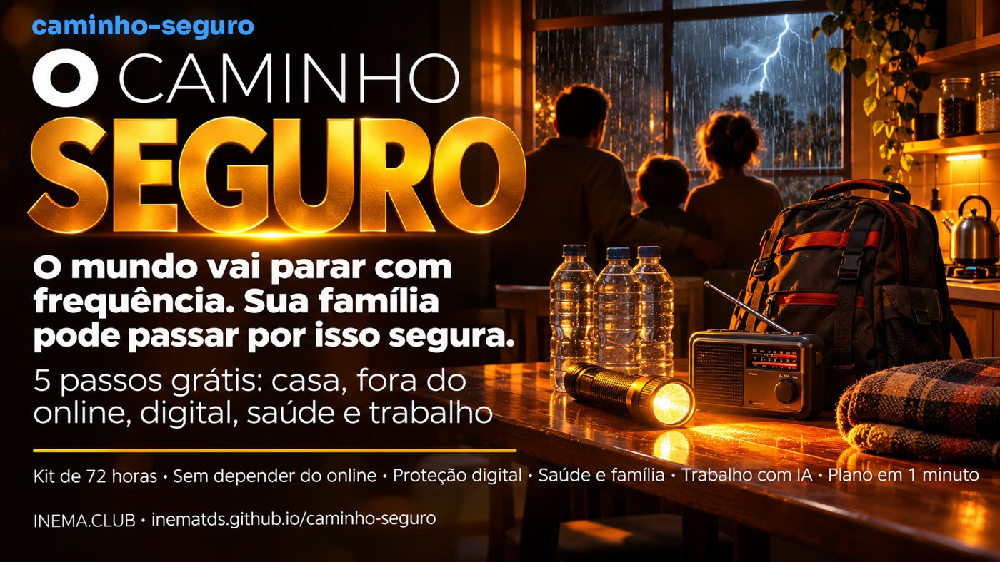

# caminho-seguro

**🇧🇷 [Português](README.md) · 🇺🇸 [English](README.en.md) · 🇪🇸 [Español](README.es.md)**

[](https://inematds.github.io/caminho-seguro/guia/)

## O que é

O caminho seguro é um guia grátis do INEMA para você e a sua família atravessarem os próximos anos de instabilidade: enchentes, tornados e calor com o El Niño muito forte, apagões, ataques a sistemas e vazamento de dados, e o trabalho mudando com robôs e inteligência artificial. São 5 passos simples: montar o kit de casa, não depender só do online, proteger as suas contas, cuidar da saúde e combinar com a família, e preparar o seu trabalho para a IA. Para ler, não precisa de nada. Se quiser, um pequeno programa monta o plano da sua casa em um minuto.

**O mundo vai parar com frequência, e quem se preparar vai passar por isso com a família segura.**
O caminho seguro é um kit grátis do INEMA com 5 passos para atravessar os próximos anos de instabilidade: clima extremo
(El Niño muito forte, enchentes, tornados, calor), ataques digitais, conflitos, e o trabalho mudando com robôs e IA.

📖 Guia: **https://inematds.github.io/caminho-seguro/guia/**

🎬 Vídeo (lives11): https://www.youtube.com/watch?v=oN9sCuGD1b4 · Short: https://youtube.com/shorts/YpXU0OIhnG4

## Os 5 passos

| Passo | O que é | Arquivo |
|---|---|---|
| 1. Casa | Kit de 72 horas da Defesa Civil (2 L de água por pessoa por dia), depois 14 dias | [passos/1-casa-72h.md](passos/1-casa-72h.md) |
| 2. Fora do online | Dinheiro vivo para alguns dias, papel, informação offline, comida sem depender do app | [passos/2-fora-do-online.md](passos/2-fora-do-online.md) |
| 3. Digital | O golpe depois do vazamento, verificação em duas etapas por aplicativo, Registrato | [passos/3-digital.md](passos/3-digital.md) |
| 4. Saúde e pessoas | Remédios com folga, combinado da família, vizinhos, alerta 40199 | [passos/4-saude-e-pessoas.md](passos/4-saude-e-pessoas.md) |
| 5. Trabalho | Certificado do seu nível de IA, a próxima tarefa para a IA, inema.club grátis | [passos/5-trabalho-ia.md](passos/5-trabalho-ia.md) |

## O seu plano em 1 minuto

```bash
git clone https://github.com/inematds/caminho-seguro && cd caminho-seguro
python3 caminho.py            # responde 7 perguntas e grava meu-plano.md
```

Ou direto: `python3 caminho.py --pessoas 4 --criancas 1 --riscos enchente,apagao,digital --saida meu-plano.md`.
Riscos: `enchente`, `vendaval`, `calor`, `apagao`, `digital`, `conflito` (`--listar-riscos`).
O plano traz água e comida para 72 h e 14 dias, os checklists dos riscos da sua região, a folha da geladeira
(199 · 193 · 192) e a data da próxima revisão (6 meses). Exemplo: [exemplo/meu-plano-exemplo.md](exemplo/meu-plano-exemplo.md).
Python 3.9+, sem instalar nada, sem internet.

## O processo, do início ao fim

| # | Passo | Comando | Quem |
|---|---|---|---|
| 1 | Ler o guia e os 5 passos | abrir https://inematds.github.io/caminho-seguro/guia/ | 🧠 você |
| 2 | Gerar o plano da sua casa | `python3 caminho.py` | ⚙️ script |
| 3 | Montar o kit de 72 horas | checklist do passo 1 no `meu-plano.md` | 🧠 você |
| 4 | Proteger as contas | passo 3 (duas etapas por app, Registrato) | 🧠 você |
| 5 | Combinar com a família e imprimir a folha da geladeira | passo 4 | 🧠 você |
| 6 | Medir o seu nível de IA | certificado do kit [nivel-ia](https://inematds.github.io/nivel-ia/guia/#certificado) | ⚙️ script / 🤖 Claude Code ou Codex |
| 7 | Chegar a 14 dias e revisar a cada 6 meses | `python3 caminho.py` de novo | 🧠 você |
| 8 | Testar o kit (para quem mexe no código) | `python3 -m pytest -q tests` | ⚙️ script |

## Biblioteca sem internet (escolha 1 de 3)

Só celular · computador simples · computador forte ([Project NOMAD](https://inematds.github.io/project-nomad/guia/)). Uma opção por aparelho, cada uma num arquivo: [offline/README.md](offline/README.md).

## Kits irmãos
- [sobreviver-ia](https://inematds.github.io/sobreviver-ia/guia/) — Wikipedia e IA offline, auditoria das contas, plano de 90 dias.
- [nivel-ia](https://inematds.github.io/nivel-ia/guia/) — o certificado do seu nível de IA.

Não substitui a orientação da Defesa Civil da sua cidade. Não é conselho financeiro nem médico.

## Licença
MIT — veja [LICENSE](LICENSE). Versão 1.0.0. Parte do ecossistema [INEMA.CLUB](https://inema.club) — grátis.

## Self-learning
Quando algo der errado, a lição vai no topo do [LESSONS.md](LESSONS.md).

## Lessons
Veja [LESSONS.md](LESSONS.md).
